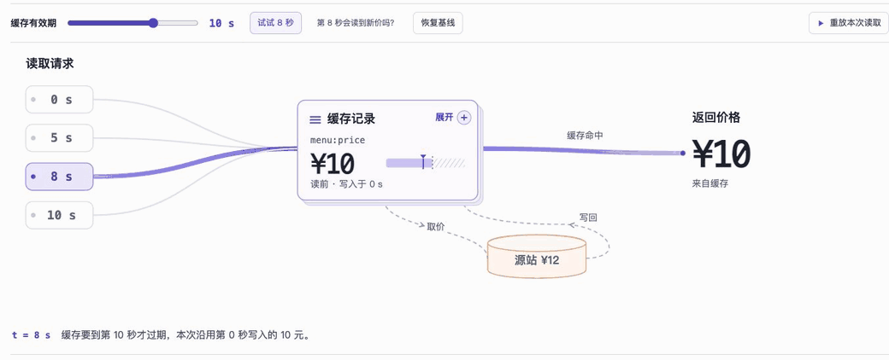

# MoonOld Skills

这里收录可以直接在 Codex 中使用的 Agent Skills。每个技能都放在独立目录，包含操作说明和配套示例。

## interactive-explainer · 交互式讲解页

用一个具体实例讲清复杂系统。读者可以沿图追踪一次请求，点开正在处理它的组件，再改一个条件，看结果从哪一步开始变化。[技能说明](skills/interactive-explainer/SKILL.md)

例如，菜单在第 6 秒从 10 元涨到 12 元，第 8 秒读取时为什么还能看到旧价？打开缓存记录可以看到，原来的有效期是 10 秒。点击「试试 8 秒」，同一次读取恰好到期，路径随即转向源站，返回 12 元。



想亲手试一下，可以下载 HTML 文件后用浏览器打开，离线也能运行。[缓存 TTL 示例](skills/interactive-explainer/assets/cache-ttl.html)

## 安装与使用

在要使用技能的项目目录里运行以下命令。需要 Node.js 22.20 或更高版本。希望所有项目都能使用时，在末尾加上 `-g`。[Skills CLI 安装说明](https://github.com/vercel-labs/skills#install-a-skill)

```sh
npx skills add MoonOld/skills --skill interactive-explainer -a codex
```

然后在 Codex 中输入：

> 用 $interactive-explainer 把这个仓库的订单同步流程做成一个交互页。让我跟着同一笔订单，看到首次确认丢失后为什么会再次投递，以及第二次投递会不会多写一行。以实际代码为准。

## 许可

本仓库的原创技能、文档和示例采用 CC0 1.0。欢迎复制、修改、商用和再分发，无需署名。链接到的第三方作品适用各自的许可条款。[许可全文](LICENSE)
